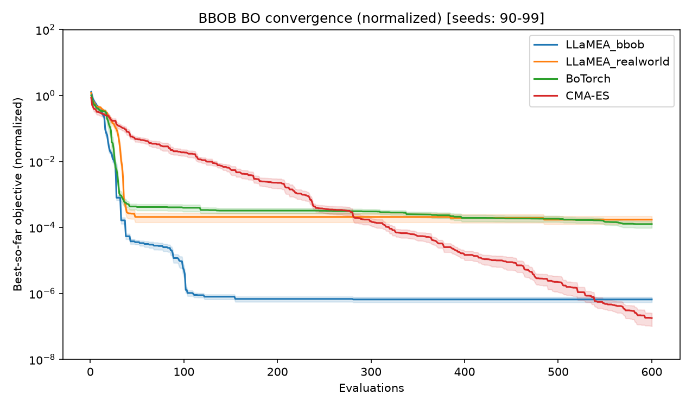
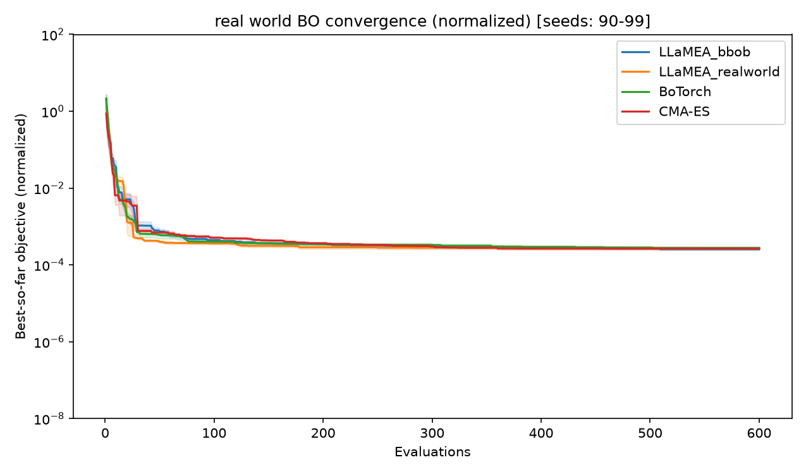

# LLaMEA-Generated Bayesian Optimization

This project uses [LLaMEA](https://github.com/XAI-liacs/LLaMEA) to generate six-dimensional Bayesian optimization (BO) algorithms. It first searches on a COCO-BBOB problem and a real-world problem from [Practical_Problems](https://github.com/BayesOptApp/Practical_Problems). The two generated algorithms are then tested on both problems and compared with CMA-ES and BoTorch.

The generated algorithms minimize the black-box objective. LLaMEA maximizes their mean AOCC score when choosing which candidate to keep. The implementation uses LLaMEA 1.4.2 and does not copy or reimplement the LLaMEA package.

## Project structure

```text
BO_LLAMEA/
├── configs/
│   └── experiment.yaml       # Problems, LLM, search and evaluation settings
├── prompts/
│   ├── bbob.txt
│   ├── realworld.txt
│   └── operators/            # Novelty operator prompts
├── runs/
│   ├── stage1.py             # Generate and select algorithms
│   └── stage2.py             # Benchmark both problems
├── src/
│   ├── problems.py           # Problem setup and AOCC references
│   ├── performance.py        # Evaluation guard, AOCC and parallel runs
│   ├── baselines.py          # CMA-ES and BoTorch implementations
│   └── utils.py              # Saving, seeds and plots
├── results/                  # Created when experiments are run
├── requirements.txt
└── README.md
```

`runs/` contains the two experiment entry points. `src/` contains code shared by the stages. `prompts/` contains the text sent to the LLM. `configs/experiment.yaml` contains the experiment settings.

## Installation

Use Python 3.11 or 3.12. Git and SWIG must also be installed.

Create a virtual environment:

```bash
python -m venv .venv
```

Activate it:

- Windows PowerShell: `.\.venv\Scripts\Activate.ps1`
- Linux/macOS: `source .venv/bin/activate`

Install SWIG with the operating system package manager, or with Conda:

```bash
conda install -c conda-forge swig
```

Install the packages:

```bash
python -m pip install -r requirements.txt
python -m pip install "git+https://github.com/BayesOptApp/Practical_Problems.git"
```

Run all commands from the folder that contains `requirements.txt`.

### Setting up the LLM

The default provider is Gemini:

```yaml
llm:
  provider: gemini
  model: gemini-3.1-flash-lite
```

Create a Gemini API key and set it as `GEMINI_API_KEY`. Do not add the key to YAML or commit it to Git.

For PowerShell:

```powershell
$env:GEMINI_API_KEY = (Get-Clipboard -Raw).Trim()
```

For Bash:

```bash
read -rs GEMINI_API_KEY
export GEMINI_API_KEY
```

It is also possible to use Ollama by setting `provider: ollama` and entering the name of an installed Ollama model.

### Prompt and hyperparameter guidance

- The base prompts are `prompts/bbob.txt` and `prompts/realworld.txt`. Edit these files to change the task instructions used for initial algorithms and later offspring.
- The files in `prompts/operators/` describe individual novelty mutations, such as surrogate, acquisition, trust-region and crossover changes. `common.txt` contains constraints shared by those mutations.
- Operator use and probabilities are set with `llamea.operators` and `llamea.operator_weights` in `configs/experiment.yaml`. Set an operator's weight to zero to disable it.
- Search sizes and selection are controlled by `n_parents`, `n_offspring`, `elitism`, `parent_selection` and `tournament_size`. `feedback` can be `basic` or `rich`; rich feedback includes more convergence and seed-variation information.

Changing prompts or these search settings changes the Stage 1 experiment. A changed run should be started as a new or tagged search. Resume should only be used when the prompt, configuration and AOCC metric are unchanged.

## Experiment settings

The example configuration currently contains:

- Group 9, so seeds 90–99
- BBOB function 1, instance 1
- Real-world problem 1124
- Dimension 6
- 60 objective calls per Stage 1 candidate run
- 600 objective calls per Stage 2 run
- `(2+2)` elitist LLaMEA search
- Roulette parent selection
- Rich feedback
- Novelty operators

The same ten seeds are used for every algorithm and both problems. Stage 1 evaluates each candidate on the ten seeds. Stage 2 evaluates each method on the ten seeds for each target.

### The main run

A short development run can use 20 candidates:

```bash
python -m runs.stage1 --target bbob --limit 20
python -m runs.stage1 --target realworld --limit 20
```

The final Stage 1 searches should use at most 100 candidates:

```bash
python -m runs.stage1 --target bbob --limit 100
python -m runs.stage1 --target realworld --limit 100
```

Then run Stage 2:

```bash
python -m runs.stage2 --budget 600 --workers 8
```

`--limit` is the total number of candidates, not the number of extra generations. `--workers` only changes process parallelism; it does not change the ten seeds.

Stage 1 and Stage 2 can be run on CPU. BoTorch and GP fitting may take longer at 600 evaluations.

### Other useful commands

```bash
# Continue an existing Stage 1 search
python -m runs.stage1 --target bbob --resume --limit 100

# Short Stage 2 development run
python -m runs.stage2 --budget 50 --workers 4

# Repeat a tagged Stage 1 search
python -m runs.stage1 --target bbob --limit 20 --tag P1 --rep 1
```

An untagged Stage 1 run replaces `results/stage1/<target>/`. Tagged runs are written below `results/stage1_runs/<tag>_r<rep>/` and are not loaded automatically by Stage 2.

Running Stage 2 again with the same budget replaces `results/stage2/budget_0600/`. Any results that need to be kept should be copied or tagged before repeating the command.

Stage 1 has a resume option. Stage 2 has no separate resume mode.

## How the program works

### Stage 1

For each target:

1. LLaMEA creates Python BO algorithm classes.
2. Every candidate is stored as source code.
3. The candidate is run with a fresh black-box problem on each of the ten seeds.
4. The program records every accepted objective call.
5. The candidate receives the mean AOCC of the ten successful runs.
6. Invalid or timed-out candidates receive fitness zero.
7. LLaMEA uses the feedback to select and mutate the next candidates.
8. The best valid candidate is saved as `best.py`.

The objective callback checks the input shape, bounds and budget. It allows at most 60 calls per candidate seed. Generated code is run in separate processes with a hard time limit, but this is not a security boundary. Untrusted code should be run in an isolated environment.

### Stage 2

Stage 2 loads the winners selected in Stage 1 and evaluates:

- the BBOB-generated algorithm,
- the real-world-generated algorithm,
- CMA-ES,
- BoTorch.

Both targets are used, for example, the BBOB winner is also tested on the real-world problem. Seed runs are executed in parallel. Each run can use at most 600 objective calls.

After each method/target combination, the program saves the per-run status and objective histories. It then calculates best-so-far trajectories and plots them with ± one standard error.

## AOCC

For a seed, let:

- \(b_t\) be the best objective found by evaluation \(t\),
- \(r\) be the problem reference,
- \(L\) and \(U\) be the lower and upper logarithmic bounds.

The current scaled AOCC calculation is:

$$
\operatorname{AOCC} =
\frac{1}{B}
\sum_{t=1}^{B}
\operatorname{clip}
\left(\frac{U-\log_{10}\left(\max\left((b_t-r)/S,10^L\right)\right)}{U-L}, 0, 1 \right)
$$

For BBOB, `r` comes from the instance-specific IOH optimum. For real-world problem 1124, `r = 0` is a lower bound because the objective is based on squared residuals.

The implementation also has an unscaled option:

```yaml
scale: null
```

This replaces `(b_t-r)/S` with `b_t-r` and should be used when the paper's unscaled log-precision formula is required.

With `scale: auto`, 32 fixed-seed points are used to estimate a target-specific scale. The points are setup calls and are not included in the 60 or 600-call optimizer budget. The calibration scale is cached in `results/calibration/`. It is not the same as the unscaled AOCC formula and should not be presented as that formula.

The current lower bound is -8 and the upper bound is 2. These values should be checked against the exact dimension-6 setup before final results are produced.

## Baselines

### CMA-ES

The current CMA-ES baseline uses `pycma`. It starts at the midpoint of the search bounds with sigma equal to 25% of the mean domain width. The implementation uses `ask/tell` and clips all proposed points into the bounds.

### BoTorch

The current BoTorch baseline uses:

- a `SingleTaskGP`,
- standardized outcomes,
- 12 scrambled Sobol initialization points,
- `LogExpectedImprovement`,
- five acquisition restarts,
- 64 raw acquisition samples.

It minimizes by giving the GP negative objective values. All initialization and acquisition evaluations count toward the configured budget.

These baseline settings are implementation choices made while building this repository. No confirmed instructor configuration for CMA-ES or BoTorch was included in the course material available for this project.

## Recorded selected algorithms

The following two winners were found in 20-candidate searches. These descriptions and pseudocode explain the specific recorded classes in `stage1/stage1/bbob/best.py` and `stage1/stage1/realworld/best.py`; they are not generic BO templates. If a later search replaces either `best.py`, the description and pseudocode must be checked against the new source code.

### BBOB winner

Candidate 15 is the selected BBOB algorithm. Its Stage 1 fitness was `0.4730794961`.

It uses:

- 12 Latin Hypercube initialization points,
- a scikit-learn Gaussian process,
- a Matérn 5/2 kernel,
- a small WhiteKernel for numerical stability,
- expected improvement,
- ten random acquisition starts plus the current incumbent,
- bounded L-BFGS-B acquisition optimization,
- GP hyperparameter optimization every fifth iteration.

The inputs are scaled to `[0,1]^6`. For the remaining calls, the algorithm updates the GP, searches for the expected-improvement maximum, and evaluates the proposal. A proposal that is too close to an existing point is replaced with a random in-bounds point.

Pseudocode:

```text
scale the bounds to [0,1]^6
sample 12 Latin Hypercube points
evaluate the initialization points

while evaluations remain:
    fit the GP
    create acquisition starting points
    optimize expected improvement
    avoid a point that is nearly duplicate
    evaluate and update the best result

return the best objective and point
```

This algorithm keeps the initialization and GP structure simple. The more unusual part is that it updates the GP after every observation but only enables hyperparameter optimization every fifth iteration. It also starts acquisition searches from both random points and the incumbent.

### Real-world winner

Candidate 14 is the selected real-world algorithm. Its Stage 1 fitness was `0.4933049959`.

It uses:

- 16 scrambled Sobol initialization points,
- a scikit-learn Gaussian process,
- a Matérn 5/2 kernel,
- objective standardization,
- expected improvement,
- ten acquisition starts,
- a local trust region,
- random fallback points.

The algorithm standardizes observed objective values before fitting the GP. It converts the GP predictions back to the original scale before calculating expected improvement. Candidate searches take place in a box around the current best point instead of across the full domain.

The trust region starts at 50% of each domain dimension. It grows after improvement and shrinks after no improvement, while staying between 5% and 50%.

Pseudocode:

```text
create a scrambled 6-D Sobol initialization design
evaluate 16 points

while evaluations remain:
    standardize the objective values
    fit the GP
    set a trust region around the incumbent
    run ten bounded L-BFGS-B searches
    evaluate the best proposed point
    grow or shrink the trust region

return the best objective and point
```

The trust region is the main feature that separates this algorithm from a standard global BO loop. Scaling the objective is also useful for this problem because its values are much larger than the BBOB values.

### Comparison

The BBOB winner uses wider exploration and periodic GP fitting. The real-world winner searches locally around the incumbent and changes its search area based on whether improvement is found.

Both use standard GP and expected-improvement components, but LLaMEA combined these components with different control strategies. The final algorithms should still be inspected after any future search, since LLaMEA output can change.

Both current winners contain broad exception fallbacks. These should be discussed as implementation risks:

- the BBOB winner catches GP fitting exceptions and continues;
- the real-world winner uses random fallback samples when an acquisition step fails.

If these sections are changed, the Stage 1 search should be rerun and the result files and README updated together.

## Results and files

Stage 1 creates:

```text
results/stage1/
├── bbob/
│   ├── best.py
│   ├── best.json
│   ├── fitness.png
│   ├── experiment.json
│   ├── code/
│   ├── traces/
│   └── exp-*/
└── realworld/
    └── same structure
```

`fitness.png` shows candidate AOCC and best-so-far fitness. `code/` contains all generated candidates and feedback. `traces/` contains the ten objective histories for each candidate. The native LLaMEA logs contain prompts, responses and evolutionary history.

Stage 2 creates:

```text
results/stage2/budget_0600/
├── experiment.json
├── summary.csv
├── bbob_runs.csv
├── bbob_statuses.csv
├── bbob_results.json
├── realworld_runs.csv
├── realworld_statuses.csv
├── realworld_results.json
└── figures/
```

The run files contain accepted objective calls and best-so-far values. The status files contain one row per seed run and include success, timeout or error information. The JSON files contain the complete recorded trajectories.

The plots show mean best-so-far performance with ± one standard error:

- BBOB: objective minus the IOH optimum
- Real-world: objective value
- Additional normalized plots use the configured reference and scale

Failed Stage 2 runs are excluded from mean convergence curves and uncertainty bands. Their failure counts remain available in the status and summary files.

## Stage 2 analysis

### Stage 2 results analysis

The following plots show the mean best-so-far convergence over ten seeds (90–99), with shaded regions indicating ±1 standard error.

**BBOB convergence**



**Real-world convergence**



| Algorithm | BBOB final objective (mean ± SE) | BBOB AOCC | Real-world final objective (mean ± SE) | Real-world AOCC |
|---|---:|---:|---:|---:|
| LLaMEA_bbob | 79.480039 ± 0.000007 | **0.7789** | **1.921107 ± 0.102408** | 0.5434 |
| LLaMEA_realworld | 79.490172 ± 0.002749 | 0.5742 | 2.032639 ± 0.181797 | **0.5487** |
| CMA-ES | **79.480011 ± 0.000005** | 0.5902 | 1.997012 ± 0.110924 | 0.5429 |
| BoTorch | 79.487469 ± 0.001755 | 0.5540 | 2.056503 ± 0.181569 | 0.5433 |

All four algorithms completed 600 evaluations on both targets across all ten seeds. Lower final objective and higher AOCC indicate better performance. On BBOB, `LLaMEA_bbob` achieved the highest AOCC, indicating faster convergence overall, while CMA-ES obtained a marginally better final objective. On the real-world problem, `LLaMEA_bbob` achieved the lowest final mean objective, demonstrating effective transfer beyond its original target. In contrast, `LLaMEA_realworld` achieved the highest real-world AOCC but did not obtain the best final objective. This difference may reflect their search strategies: the BBOB winner uses global expected-improvement optimization with periodic GP hyperparameter tuning, while the real-world winner uses an adaptive local trust region and more frequent GP fitting. Overall, the results suggest stronger generalization by the BBOB-generated algorithm, whereas the real-world-generated algorithm shows some specialization in convergence behavior but no consistent advantage in final solution quality. The small real-world differences relative to their standard errors warrant cautious interpretation.

All reported values are taken from `results/stage2/budget_0600/summary.csv` and can be verified against the corresponding `bbob_results.json`, `realworld_results.json`, and per-seed status files.

## Reproducibility and logging

The experiment records the YAML configuration, prompts, seeds, budgets, metric settings, selected methods and package versions. It also saves candidate source code and per-seed traces.

Before the final benchmark, also record:

- the CPU model,
- logical core count,
- RAM,
- operating system,
- Python package versions,
- GPU or accelerator, if used,
- the actual LLM model and provider,
- the selected BBOB and real-world problem,
- the BoTorch settings used,
- the exact AOCC mode and bounds.

The 32 calibration points are separate setup evaluations and must not be added to the 60 or 600 objective budget.

Native IOH logging is optional. The project JSON and CSV traces are the complete assignment logs. Native IOH logs can be enabled with `stage2.ioh_logging: true`, but they supplement rather than replace the custom traces.

Generated Python is executed dynamically in subprocesses. The timeout prevents a run from continuing indefinitely, but it does not make generated code safe. Run the project in an isolated environment if the generated code is not trusted.

## Limitations

The exact baseline settings mentioned in the assignment could not be found in the course material available to us. In particular:

- the required CMA-ES initialization and step-size settings,
- the required BoTorch surrogate and acquisition settings,
- the exact number of BoTorch initialization points,
- and the exact acquisition optimization settings.

The baseline implementations therefore use documented provisional choices:

- CMA-ES starts at the search-space midpoint with initial sigma equal to 25% of the mean domain width;
- BoTorch uses 12 scrambled Sobol initialization points, a `SingleTaskGP`, standardized outcomes, `LogExpectedImprovement`, five acquisition restarts and 64 raw samples.

These values were not confirmed as instructor-specified settings. If the setting is changed, all methods must still be run with the same evaluation budget and the same seed set.


## Dependencies and attribution

This project uses [LLaMEA](https://github.com/XAI-liacs/LLaMEA), [IOH](https://github.com/IOHprofiler/IOHexperimenter), [Practical_Problems](https://github.com/BayesOptApp/Practical_Problems), [pycma](https://github.com/CMA-ES/pycma), [BoTorch](https://github.com/pytorch/botorch), [GPyTorch](https://github.com/cornellius-gp/gpytorch) and [scikit-learn](https://scikit-learn.org/).
